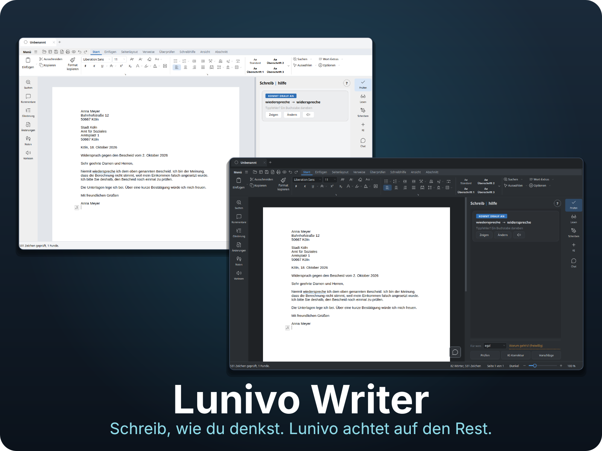

# Lunivo Writer

Eine native Textverarbeitung für Linux, entwickelt mit Python 3 und PySide6/Qt Widgets. Die Schreibhilfe sitzt neben dem Dokument und zeigt Fundstellen mit Erklärungen und Vorschlägen. Änderungen übernimmt Lunivo nur auf deine Auswahl.

Lunivo braucht kein Konto und keine Internetverbindung für Schreiben, Prüfen und Speichern. Optionale Online-KI und externe Schreibhilfen werden erst nach eigener Einrichtung verwendet.

## Die Idee hinter Lunivo

Rechtschreibung und Kreativität sollen Hand in Hand gehen.

Mein Anspruch ist es, ein professionelles Office-Programm zu entwickeln und gleichzeitig eine leistungsfähige Rechtschreibhilfe zu schaffen. Beides soll gleichwertig sein und ohne Abstriche weiterentwickelt werden.

Lunivo soll nicht einfach ein Office-Programm mit einer zusätzlichen Rechtschreibfunktion sein. Es soll alle Möglichkeiten bieten, die man von einer modernen Textverarbeitung erwartet, und gleichzeitig Menschen beim Schreiben unterstützen.

Denn Schwierigkeiten mit der Rechtschreibung bedeuten nicht, weniger Ideen, Fantasie oder Kreativität zu haben. Die Rechtschreibhilfe soll den eigenen Schreibstil nicht einschränken, sondern dabei helfen, Gedanken so auszudrücken, wie man es möchte.

**Die Rechtschreibhilfe soll Kreativität ermöglichen, nicht begrenzen. Und ein professionelles Office-Programm soll dabei niemals zu kurz kommen.**

## Voraussetzungen

- Linux (getestet unter Linux Mint); Windows und macOS werden in der CI nur teilweise geprüft.
- Python 3.10 oder neuer mit `python3-venv`.
- Qt-Systembibliotheken, unter Debian/Ubuntu/Mint: `sudo apt install libxcb-cursor0 libegl1 libxkbcommon-x11-0 libxcb-icccm4 libxcb-keysyms1 libxcb-shape0`
- Internet nur für die Einrichtung (Python-Pakete werden geladen).

## Installation und Start

```bash
git clone https://github.com/nullforge86/Lunivo-Office.git
cd Lunivo-Office
./starten-qt.sh
```

Beim ersten Start legt das Skript eine eigene `.venv` an und installiert die Abhängigkeiten aus `requirements.txt` (PySide6, python-docx, msoffcrypto-tool, pyphen, pypdf). Das System-Python bleibt unberührt.

Eine Datei direkt öffnen:

```bash
./starten-qt.sh brief.docx
```

`./starten-qt.sh --eintrag` legt einen Eintrag im Anwendungsmenü an, `./starten-qt.sh --weg` entfernt ihn (Umgebung und Dokumente bleiben). Mehr in der [Installationsanleitung](docs/INSTALLATION.md).

## Was Lunivo kann

- Acht Register: Start, Einfügen, Seitenlayout, Verweise, Überprüfen, Schreibhilfe, Ansicht und Abschnitt (Sendungen lässt sich einblenden).
- Eine Schreibhilfe für häufige Verwechslungen, Rechtschreibung, Grammatik, Wortvorhersage, Silbentrennung und Vorlesen.
- Tabellen, Bilder, Formen, Diagramme, Formeln, Formatvorlagen, Kopf- und Fußzeilen sowie Seriendruck.
- Eine native Qt-Oberfläche mit Seitenleiste, Dokumentreitern und wahlweise Registerband oder Symbolleisten.

## Dateiformate

| Aktion | Formate |
|---|---|
| Öffnen und Speichern | DOCX, ODT, FODT, RTF, TXT |
| Nur exportieren | PDF, PNG |

PDF kann Lunivo nicht öffnen. XLSX, XLS, PPTX, PPT sowie die alten DOC/DOT-Formate werden nicht unterstützt. Grenzen der Formatunterstützung: [Speichern und Dateiformate](docs/SPEICHERN.md).

## Offline und online

**Offline (ohne Konto, ohne Internet):** Schreiben, Bearbeiten, Speichern, Rechtschreib- und Grammatikprüfung, Wortvorhersage, Silbentrennung, Seriendruck, PDF-Export.

**Optional, nach eigener Einrichtung:**

| Funktion | Voraussetzung | Internet |
|---|---|---|
| Lokale KI | Ollama mit heruntergeladenem Modell | nur zum Laden des Modells |
| Gründlichere Grammatikprüfung | LanguageTool und Java | nur zum Laden |
| Aufgenommene Stimmen, Leseschriften | `./stimme-holen.sh`, `./schrift-holen.sh` | nur zum Laden |
| Online-KI, Websuche | eigener API-Schlüssel des Anbieters | ja; der gewählte Text wird an den Anbieter übertragen |

## Datenschutz

Dokumente bleiben am gewählten Speicherort. Einstellungen und Anwendungsdaten liegen in den XDG-Verzeichnissen des Benutzers. Online-Dienste werden nur nach eigener Einrichtung verwendet; lokale Funktionen laufen ohne sie weiter.

## Hilfe und Dokumentation

Im Programm: **☰ Menü → Hilfe → Handbuch**.

- [Lies mich](docs/LIESMICH.md)
- [Installation](docs/INSTALLATION.md)
- [Lesen und Schreiben](docs/lesen-und-schreiben.md)
- [Prüfung, Vorhersage und KI](docs/pruefung-und-ki.md)
- [KI-Handbuch: Funktionen, Bedienung und Einstellungen](docs/HANDBUCH-KI.md)
- [Schreiben und Dokumente](docs/schreiben-und-dokumente.md)
- [Einstellungen](docs/einstellungen.md)
- [Speichern, Formate und Datensicherheit](docs/SPEICHERN.md)
- [Oberfläche](docs/oberflaeche.md)
- [Projektaufbau](docs/README.md)
- [Aufbau: Registerband](docs/aufbau-band.md)
- [Aufbau: Ist-Stand](docs/aufbau-ist-stand.md)
- [Aufbau: Optionen](docs/aufbau-optionen.md)
- [Baukasten](docs/baukasten.md)
- [Konzept: Optionen](docs/konzept-optionen.md)
- [Tabellen und Steuerung](docs/tabellen-und-steuerung.md)
- [UI-Technologie](docs/ui-technologie.md)
- [Interne Funktionen (Inventar)](docs/interne-funktionen.md)
- [Erweiterungen](docs/erweiterungen.md)
- [Entstehung](docs/ENTSTEHUNG.md)
- [Wohin Lunivo gehen soll](docs/RICHTUNG.md)
- [Mitwirken](.github/CONTRIBUTING.md)

## Mitmachen

Lunivo wird derzeit von mir allein entwickelt. Hinter dem Projekt steht kein großes Team. Ich stelle mich der Herausforderung, ein professionelles Office-Programm und eine leistungsfähige Rechtschreibhilfe gleichermaßen weiterzuentwickeln.

Ich möchte Lunivo aber nicht nur für mich entwickeln. Erfahrungen, Fragen und Verbesserungsvorschläge sind willkommen. Besonders freue ich mich über Rückmeldungen von Menschen mit Legasthenie. Eure Erfahrungen können helfen, Lunivo besser zu machen.

Du musst kein Entwickler sein und keine perfekte Rechtschreibung haben, um dich einzubringen. **Rechtschreibung muss dabei keine Rolle spielen.**

Nutze dafür die [GitHub Discussions](../../discussions) oder melde einen [Fehler](../../issues/new?template=fehler.yml) beziehungsweise einen [Funktionswunsch](../../issues/new?template=wunsch.yml).

## Lizenz

Lunivo steht unter der [MIT-Lizenz](LICENSE). Die mitgelieferten Lucide-Zeichnungen stehen unter ISC; der Lizenztext liegt in [docs/LIZENZ-LUCIDE.txt](docs/LIZENZ-LUCIDE.txt).
