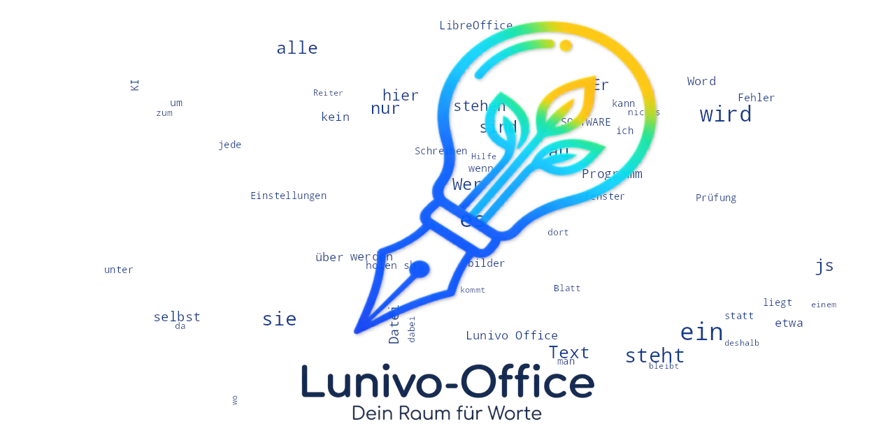

# Lunivo Writer

Eine native Textverarbeitung für Linux, entwickelt mit Python 3 und PySide6/Qt Widgets. Die Schreibhilfe sitzt neben dem Dokument und zeigt Fundstellen mit Erklärungen und Vorschlägen. Änderungen übernimmt Lunivo nur auf deine Auswahl.

Lunivo braucht kein Konto und keine Internetverbindung für Schreiben, Prüfen und Speichern. Optionale Online-KI und externe Schreibhilfen werden erst nach eigener Einrichtung verwendet.

## Die Idee hinter Lunivo

Rechtschreibung und Kreativität sollen Hand in Hand gehen.

Mein Anspruch ist es, ein professionelles Office-Programm zu entwickeln und gleichzeitig eine leistungsfähige Rechtschreibhilfe zu schaffen. Beides soll gleichwertig sein und ohne Abstriche weiterentwickelt werden.

Lunivo soll nicht einfach ein Office-Programm mit einer zusätzlichen Rechtschreibfunktion sein. Es soll alle Möglichkeiten bieten, die man von einer modernen Textverarbeitung erwartet, und gleichzeitig Menschen beim Schreiben unterstützen.

Denn Schwierigkeiten mit der Rechtschreibung bedeuten nicht, weniger Ideen, Fantasie oder Kreativität zu haben. Die Rechtschreibhilfe soll den eigenen Schreibstil nicht einschränken, sondern dabei helfen, Gedanken so auszudrücken, wie man es möchte.

**Die Rechtschreibhilfe soll Kreativität ermöglichen, nicht begrenzen. Und ein professionelles Office-Programm soll dabei niemals zu kurz kommen.**

## Installation und Start

Voraussetzung ist Python 3.10 oder neuer (Linux). Beim ersten Start richtet das Skript eine eigene `.venv` ein und installiert die Projektabhängigkeiten (PySide6, python-docx, pyphen, pypdf, msoffcrypto-tool):

```bash
./starten-qt.sh
```

Eine Datei lässt sich direkt öffnen:

```bash
./starten-qt.sh brief.docx
```

Mit `./starten-qt.sh --eintrag` wird ein Menüeintrag angelegt. `./starten-qt.sh --weg` entfernt diesen Eintrag; Programmumgebung und Dokumente bleiben erhalten.

## Was Lunivo kann

- Acht Register: Start, Einfügen, Seitenlayout, Referenzen, Überprüfen, Schreibhilfe, Sendungen und Ansicht.
- Eine Schreibhilfe für häufige Verwechslungen, Rechtschreibung, Grammatik, Wortvorhersage, Silbentrennung und Vorlesen.
- Dokumente in DOCX, ODT, FODT, RTF und TXT öffnen oder speichern. PDF und PNG lassen sich exportieren; PDF kann Lunivo nicht öffnen.
- Tabellen, Bilder, Formen, Diagramme, Formeln, Formatvorlagen, Kopf- und Fußzeilen sowie Seriendruck.
- Eine native Qt-Oberfläche mit Seitenleiste, Dokumentreitern und wahlweise Registerband oder Symbolleisten.

XLSX, XLS, PPTX, PPT sowie die alten DOC/DOT-Formate werden nicht unterstützt. Die bekannte Formatunterstützung und ihre Grenzen stehen in [Speichern und Dateiformate](docs/SPEICHERN.md).

## Offline und online

- **Offline:** Schreiben, Formatieren, Rechtschreib- und Grammatikprüfung, Wortvorhersage, Silbentrennung, Öffnen, Speichern und Exportieren.
- **Nur mit Internet und eigener Einrichtung:** optionale KI-Anbieter und externe Schreibhilfen; Zusatzdaten wie Schriften oder Stimmen holen `schrift-holen.sh` und `stimme-holen.sh`.

## Tests

```bash
.venv/bin/python -m pytest tests/test_formats.py
```

Eine gezielte Auswahl genügt lokal; die Gesamtprüfung läuft bei Push und Pull Request über GitHub Actions.

## Datenschutz

Dokumente bleiben an dem Speicherort, den du auswählst. Einstellungen und Anwendungsdaten liegen in den XDG-Verzeichnissen des Benutzers. Optionale KI-Anbieter und Online-Dienste brauchen eine eigene Einrichtung; lokale Funktionen laufen ohne sie weiter.

## Dokumentation

**Für Nutzer**

- [Installation](docs/INSTALLATION.md)
- [Überblick](docs/LIESMICH.md)
- [Lesen und Schreiben](docs/lesen-und-schreiben.md)
- [Prüfung, Vorhersage und KI](docs/pruefung-und-ki.md)
- [Schreiben und Dokumente](docs/schreiben-und-dokumente.md)
- [Einstellungen](docs/einstellungen.md)
- [Speichern, Formate und Datensicherheit](docs/SPEICHERN.md)
- [Oberfläche](docs/oberflaeche.md)
- [Entstehung](docs/ENTSTEHUNG.md) und [Wohin Lunivo gehen soll](docs/RICHTUNG.md)

**Für Entwickler:** Projektaufbau, Baukasten, Registerband und Funktionsinventar stehen in [docs/entwicklung](docs/entwicklung/README.md).

Weitere Hilfe gibt es im Programm unter **☰ Menü → Hilfe → Handbuch**.

## Mitmachen

Lunivo wird derzeit von mir allein entwickelt. Hinter dem Projekt steht kein großes Team. Ich stelle mich der Herausforderung, ein professionelles Office-Programm und eine leistungsfähige Rechtschreibhilfe gleichermaßen weiterzuentwickeln.

Ich möchte Lunivo aber nicht nur für mich entwickeln. Erfahrungen, Fragen und Verbesserungsvorschläge sind willkommen. Besonders freue ich mich über Rückmeldungen von Menschen mit Legasthenie. Eure Erfahrungen können helfen, Lunivo besser zu machen.

Du musst kein Entwickler sein und keine perfekte Rechtschreibung haben, um dich einzubringen. **Rechtschreibung muss dabei keine Rolle spielen.**

Nutze dafür die [GitHub Discussions](../../discussions) oder melde einen [Fehler](../../issues/new?template=fehler.yml) beziehungsweise einen [Funktionswunsch](../../issues/new?template=wunsch.yml).

## Lizenz

Lunivo steht unter der [MIT-Lizenz](LICENSE). Die mitgelieferten Lucide-Zeichnungen stehen unter ISC; der Lizenztext liegt in [docs/LIZENZ-LUCIDE.txt](docs/LIZENZ-LUCIDE.txt).

