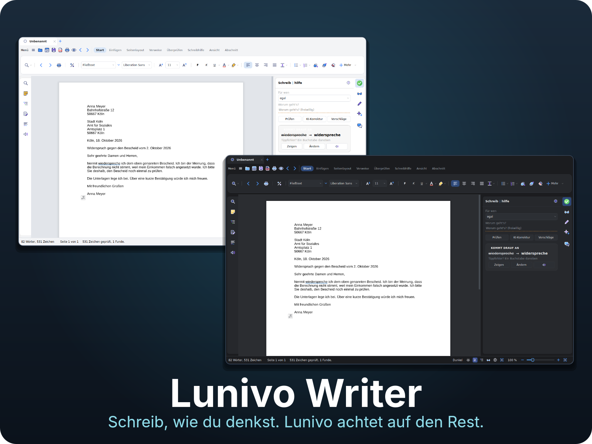

# Lunivo Writer

Eine native Textverarbeitung für Linux, entwickelt mit Python 3 und PySide6/Qt Widgets. Die Schreibhilfe sitzt neben dem Dokument und zeigt Fundstellen mit Erklärungen und Vorschlägen. Änderungen übernimmt Lunivo nur auf deine Auswahl.

Lunivo braucht kein Konto und keine Internetverbindung für Schreiben, Prüfen und Speichern. Optionale Online-KI und externe Schreibhilfen werden erst nach eigener Einrichtung verwendet.

## Die Idee hinter Lunivo

Rechtschreibung und Kreativität sollen Hand in Hand gehen.

Mein Anspruch ist es, ein professionelles Office-Programm zu entwickeln und gleichzeitig eine leistungsfähige Rechtschreibhilfe zu schaffen. Beides soll gleichwertig sein und ohne Abstriche weiterentwickelt werden.

Lunivo soll nicht einfach ein Office-Programm mit einer zusätzlichen Rechtschreibfunktion sein. Es soll alle Möglichkeiten bieten, die man von einer modernen Textverarbeitung erwartet, und gleichzeitig Menschen beim Schreiben unterstützen.

Denn Schwierigkeiten mit der Rechtschreibung bedeuten nicht, weniger Ideen, Fantasie oder Kreativität zu haben. Die Rechtschreibhilfe soll den eigenen Schreibstil nicht einschränken, sondern dabei helfen, Gedanken so auszudrücken, wie man es möchte.

**Die Rechtschreibhilfe soll Kreativität ermöglichen, nicht begrenzen. Und ein professionelles Office-Programm soll dabei niemals zu kurz kommen.**

## Installation und Start

| Weg | Linux | Windows | macOS |
|---|---|---|---|
| Installieren | `sudo apt install ./Lunivo-Office_0.1.0_amd64.deb` | `Lunivo-Office_0.1.0_Setup.exe` ausführen | `.dmg` öffnen, App nach „Programme“ ziehen |
| Ohne Installation testen | `…_linux-portable.tar.gz` entpacken, `lunivo-office/lunivo-office` starten | `…_windows-portable.zip` entpacken, `lunivo-office\lunivo-office.exe` starten | `…-portable.zip` entpacken, App per Rechtsklick → „Öffnen“ starten |
| Aus dem Quellcode | `./skripte/starten-qt.sh` | `python main.py` | `python3 main.py` |

Pakete und portable Archive bringen Python und alle Bibliotheken mit. Jedes wird auf seinem eigenen Betriebssystem gebaut und enthält die dafür passenden Bibliotheken; beim Installieren wird nichts nachgeladen. Zur Laufzeit erkennt das Programm das Betriebssystem selbst und wählt danach seine Ordner für Einstellungen, Daten und Zusatzpakete.

### Aus dem Quellcode (Linux)

Benötigt Python 3.10 oder neuer mit `python3-venv` und die Qt-Systembibliotheken (Debian/Ubuntu/Mint: `sudo apt install libxcb-cursor0 libegl1 libxkbcommon-x11-0 libxcb-icccm4 libxcb-keysyms1 libxcb-shape0`).

```bash
git clone https://github.com/nullforge86/Lunivo-Office.git
cd Lunivo-Office
./skripte/starten-qt.sh
```

Beim ersten Start legt das Skript eine eigene `.venv` an und installiert die Abhängigkeiten aus `requirements.txt`; dafür wird einmalig Internet benötigt. Das System-Python bleibt unberührt.

Eine Datei direkt öffnen:

```bash
./skripte/starten-qt.sh brief.docx
```

`./skripte/starten-qt.sh --eintrag` legt einen Eintrag im Anwendungsmenü an, `./skripte/starten-qt.sh --weg` entfernt ihn (Umgebung und Dokumente bleiben).

### Aus dem Quellcode (Windows, macOS)

```bash
python -m venv .venv
.venv/bin/python -m pip install -r requirements.txt
.venv/bin/python main.py
```

Unter Windows heißt der Pfad `.venv\Scripts\python`. Alle Schritte je Betriebssystem, die Ordner des Programms und die Zusatzpakete stehen in der [Installationsanleitung](dokumentation/benutzerhandbuch/installation.md).

## Was Lunivo kann

- Acht Register: Start, Einfügen, Seitenlayout, Verweise, Überprüfen, Schreibhilfe, Ansicht und Abschnitt (Sendungen lässt sich einblenden).
- Eine Schreibhilfe für häufige Verwechslungen, Rechtschreibung, Grammatik, Wortvorhersage, Silbentrennung und Vorlesen.
- Tabellen, Bilder, Formen, Diagramme, Formeln, Formatvorlagen, Kopf- und Fußzeilen sowie Seriendruck.
- Eine native Qt-Oberfläche mit Seitenleiste, Dokumentreitern und wahlweise Registerband oder Symbolleisten.

## Dateiformate

| Aktion | Formate |
|---|---|
| Öffnen und Speichern | DOCX, ODT, FODT, RTF, TXT |
| Nur exportieren | PDF, PNG |

PDF kann Lunivo nicht öffnen. XLSX, XLS, PPTX, PPT sowie die alten DOC/DOT-Formate werden nicht unterstützt. Grenzen der Formatunterstützung: [Dateiformate](dokumentation/benutzerhandbuch/formate.md) und [Speichern](dokumentation/benutzerhandbuch/speichern.md).

## Offline und online

**Offline (ohne Konto, ohne Internet):** Schreiben, Bearbeiten, Speichern, Rechtschreib- und Grammatikprüfung, Wortvorhersage, Silbentrennung, Seriendruck, PDF-Export.

**Optional, nach eigener Einrichtung:**

| Funktion | Voraussetzung | Internet |
|---|---|---|
| Lokale KI | Ollama mit heruntergeladenem Modell | nur zum Laden des Modells |
| Gründlichere Grammatikprüfung | LanguageTool und Java | nur zum Laden |
| Aufgenommene Stimmen, Leseschriften | `./skripte/stimme-holen.sh`, `./skripte/schrift-holen.sh` (Linux) | nur zum Laden |
| Online-KI, Websuche | eigener API-Schlüssel des Anbieters | ja; der gewählte Text wird an den Anbieter übertragen |

## Datenschutz

Dokumente bleiben am gewählten Speicherort. Einstellungen und Anwendungsdaten liegen in den Benutzerordnern des Betriebssystems (Linux: XDG-Verzeichnisse, Windows: `%APPDATA%`, macOS: `~/Library`). Online-Dienste werden nur nach eigener Einrichtung verwendet; lokale Funktionen laufen ohne sie weiter.

## Hilfe und Dokumentation

Im Programm: **☰ Menü → Hilfe → Handbuch**.

**Benutzerhandbuch**

- [Lies mich](dokumentation/benutzerhandbuch/liesmich.md)
- [Installation](dokumentation/benutzerhandbuch/installation.md)
- [Oberfläche](dokumentation/benutzerhandbuch/oberflaeche.md)
- [Lesen und Schreiben](dokumentation/benutzerhandbuch/lesen-und-schreiben.md)
- [Schreiben und Dokumente](dokumentation/benutzerhandbuch/schreiben-und-dokumente.md)
- [Tabellen und Steuerung](dokumentation/benutzerhandbuch/tabellen-und-steuerung.md)
- [Prüfung, Vorhersage und KI](dokumentation/benutzerhandbuch/pruefung-und-ki.md)
- [Einstellungen](dokumentation/benutzerhandbuch/einstellungen.md)
- [Speichern und Datensicherheit](dokumentation/benutzerhandbuch/speichern.md)
- [Dateiformate](dokumentation/benutzerhandbuch/formate.md)

**Aufbau des Programms**

- [Projektaufbau](dokumentation/README.md)
- [Aufbau: Registerband](dokumentation/architektur/aufbau-band.md)
- [Aufbau: Ist-Stand](dokumentation/architektur/aufbau-ist-stand.md)
- [Aufbau: Optionen](dokumentation/architektur/aufbau-optionen.md)
- [Aufbau: Dropdown-Menüs](dokumentation/architektur/dropdown-architektur.md)
- [Layout-Schicht](dokumentation/architektur/layout-schicht.md)
- [UI-Technologie](dokumentation/architektur/ui-technologie.md)
- [Baukasten](dokumentation/entwicklung/baukasten.md)
- [Plattformen](dokumentation/entwicklung/plattformen.md)
- [Erweiterungen](dokumentation/entwicklung/erweiterungen.md)
- [Interne Funktionen (Inventar)](dokumentation/entwicklung/interne-funktionen.md)
- [Installationspakete](installationspakete/README.md)

**Hintergrund**

- [Entstehung](dokumentation/entwicklung/entstehung.md)
- [Wohin Lunivo gehen soll](dokumentation/konzepte/richtung.md)
- [Konzept: Optionen](dokumentation/konzepte/konzept-optionen.md)
- [Konzept: Symbolsystem](dokumentation/konzepte/symbolsystem/konzept.md)

## Mitmachen

Lunivo wird derzeit von mir allein entwickelt. Hinter dem Projekt steht kein großes Team. Ich stelle mich der Herausforderung, ein professionelles Office-Programm und eine leistungsfähige Rechtschreibhilfe gleichermaßen weiterzuentwickeln.

Ich möchte Lunivo aber nicht nur für mich entwickeln. Erfahrungen, Fragen und Verbesserungsvorschläge sind willkommen. Besonders freue ich mich über Rückmeldungen von Menschen mit Legasthenie. Eure Erfahrungen können helfen, Lunivo besser zu machen.

Du musst kein Entwickler sein und keine perfekte Rechtschreibung haben, um dich einzubringen. **Rechtschreibung muss dabei keine Rolle spielen.**

Nutze dafür die [GitHub Discussions](../../discussions) oder melde einen Fehler oder einen Funktionswunsch als [Issue](../../issues/new).

## Lizenz

Lunivo steht unter der [MIT-Lizenz](LICENSE). Die mitgelieferten Lucide-Zeichnungen stehen unter ISC; der Lizenztext liegt in [dokumentation/LIZENZ-LUCIDE.txt](dokumentation/LIZENZ-LUCIDE.txt).
