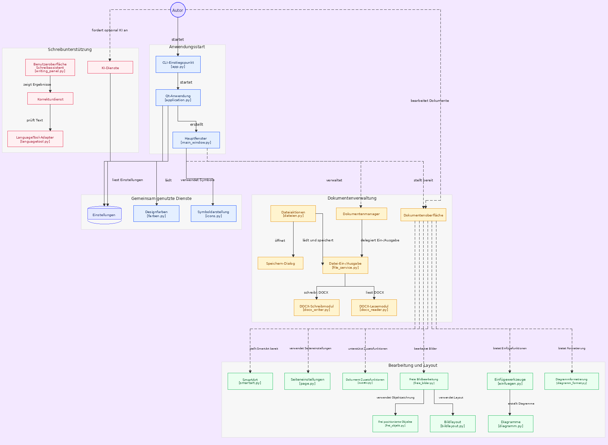

# Projektaufbau

Lunivo Writer ist eine native Desktop-Anwendung mit Python 3 und PySide6/Qt Widgets. Das Programm startet über `./starten-qt.sh` oder mit `python -m lunivo_writer`; es verwendet keine Weboberfläche.

## Verzeichnisübersicht

```text
src/lunivo_writer/
  app.py, __main__.py       Einstiegspunkte
  core/                     Anwendung, Dokumentverwaltung und Befehlssteuerung
    befehle/                Befehle: hauptreiter/ (Datei, Text, Einfügen, Seite, Verweise, Überprüfen …), kontextreiter/ (Bild-, Form-, Diagramm-, SmartArt-, Text-, Kopf-/Fußzeilen-Tools), hilfen.py
  ui/                       Fenster und Qt-Oberfläche
    main_window.py          Hauptfenster
    backstage.py            Datei-Menü und Dokumentaktionen
    ribbon/                 Registerband, Symbolleisten und Menüleiste
    contextual/             Kontext-Reiter (Tabellen, Bilder, Formen, Diagramme, Text, Kopf-/Fußzeile, Seriendruck)
    hauptfenster/           Bausteine des Hauptfensters (Dateien, Bearbeiten, Oberfläche, Datei-Ansicht)
    document/               Dokumenteditor und Dokumentfenster: bearbeitung/ (Editor und seine Mixins), dokumentfenster/ (Dokument, Reiter, linke Seitenleiste), ansicht/ (Lineal, Sprechblasen, Seitenansicht), kopffuss/, tabelle/
    sidebar/                 Schreibhilfe- und KI-Seitenleisten
    dialogs/                 Dialoge und Optionen: einfuegen/, ki/, verweise/, sendungen/, lesen_hilfe/ sowie Optionen und kleine Dialoge
    baukasten/               Gemeinsame Oberflächenbausteine, nach Zuständigkeit in Unterpaketen:
      basis/                 Palette (farben), Maße (mass), Texte, Linien, Karte, Dialoggerüst
      geruest/               Fenster- und Panelgerüst: Zusatzpanel, Fensterstapel, Einklappgruppe, Aktionsleiste, Werkbank
      controls/              Eingabeelemente: Maßfelder, Formular-Gitter, Reiterleiste, Schieber, Schalter, Farbwähler
      dropdown/              Auswahlfeld, Menüs, Popup-Verhalten; auswahl/ (Farbpalette, Raster, Symbole), objektmenues/ (Bild-, Form-, Diagramm-Menüs, Voreinstellungen)
      formatierung/          Format-Panels und -Dialoge (Absatz, Schrift, Objekt, Text-Effekte, Formatvorlagen)
      dokument/              Dialoge rund um Dokument und Seite (Layout, Druck, Liste, Eingabe, Erstellen)
      diagramme/             Format-Panels für Diagramm und SmartArt
      medien/                Bild-, Datei-, Listen-, Umbruch- und Seitensymbole, Bild-Export
      vorlagen/              Vorlagen-Galerie
      chat/                  Bausteine der KI-Seitenleiste
    statusbar/               Statusleiste
  plattform/                Betriebssystem-Abhängiges an einer Stelle: pfade (QStandardPaths), sperre (Dateisperre), protokoll (Logdatei)
  editor/                   Dokumentoperationen und Textlogik, nach Zuständigkeit in Unterpaketen:
    seite/                  Seitenumbruch, Seitenfluss, Abschnitte, Kopf-/Fußbereich-Hilfen, Druck, Deckblatt
    text/                   Zeichen- und Absatzformat, Stile, Listen, Suchen, Texteffekte, Muster, Zahlformate
    objekte/                Bilder, Formen, freie Objekte, SmartArt, Linien, Sprechblasen
    tabelle/                Tabellenstil, -zustand, -eigenschaften, Text in Tabelle
    dokument/               Einfügen, Felder, Formular, Verweise, Verzeichnisse, Vergleich, Sendungen, Vorlagen
    diagramme/              Diagrammzeichnung, Geometrie, Formatierung und Teil-Auswahl
  models/                   Dokument- und Seitendaten
  services/                 Datei-, Einstellungs-, Wiederherstellungs- und Exportdienste; rtf/ (RTF-Import: Zerleger, Steuerwörter, Gruppen, Aufbau), docx_teile/ (DOCX), odt_*.py (ODT)
  ai/                       KI-Anbieter und KI-Aufgaben; ki.py (Klasse KI) mit ki_transport, ki_claude, ki_ollama, ki_eigen, ki_werkzeugschleife, ki_textaktionen, ki_bildgenerierung
  proofing/                 Rechtschreibprüfung, Vorhersage und Barrierefreiheit
  resources/                Handbuch, Registerdefinitionen und Wörterdaten
assets/                     Symbole, Logos und weitere Laufzeitressourcen
docs/                       Projekt- und Benutzerdokumentation; berichte/ enthält die Prüf-, Test- und Abschlussberichte
tests/                      Gezielte pytest-Tests
werkzeug/                   Entwicklungs- und Prüfhilfen: pruefen/ (funktionspruefung.py: Band; seitenleistenpruefung.py: Seitenleiste „Formatierung“ durchklicken; importpruefung.py: Importpfade; speicherpruefung.py; kontrast.py; docx_korpus.py), bauen/ (inventar-bauen.py: docs/interne-funktionen.md neu erzeugen; module_verschieben.py; deb-bauen.sh; titelbild.py), symbole/ (Symbol-Werkzeuge), git-haken/ und haken-an.sh
```

## Architekturübersicht



## Zuständigkeiten

- **core** steuert den Programmablauf und vermittelt Befehle.
- **ui** zeigt Dokumente, Register, Seitenleisten und Dialoge.
- **editor** führt Dokumentänderungen aus.
- **editor/** ist in `seite`, `text`, `objekte`, `tabelle`, `dokument` und `diagramme` gegliedert. Alte Weiterleitungen gibt es nicht mehr; `werkzeug/pruefen/importpruefung.py` (und `tests/plattform/test_importpfade.py`) prüft nach jedem Verschieben alle Importpfade. `werkzeug/bauen/module_verschieben.py` verschiebt Module und zieht alle Verweise mit.
- **models** hält Dokument- und Seitendaten.
- **services** liest und schreibt Dateien, Einstellungen und Sicherungen.
- **plattform** kapselt Pfade, Dateisperre und Protokoll; nur dort steht Code, der je nach Betriebssystem verschieden ist.
- **proofing** prüft und erklärt Textstellen (jeder Prüfer in `proofing/pruefung.py` hat einen Namen und lässt sich über `schreibhilfe/pruefer_<name>` ausschalten; `models/proofing.py` hat das gemeinsame Fundmodell `ProofingIssue`); **ai** stellt optionale KI-Aufgaben bereit.

Die Richtung der Abhängigkeiten bleibt einfach: Oberfläche und core verwenden editor, models und services. Fachlogik liegt nicht in den Widgets.

Diese Richtung prüft `tests/editor/test_schichten.py`: `editor/`, `services/`, `models/` und `proofing/` importieren nichts aus `ui/`. Zwei Altfälle stehen als Ausnahme in der Liste des Tests (`editor/dokument/formular.py`, `editor/dokument/einfuegen.py`); sie darf nur kleiner werden. `core/befehle/` ist die Anwendungsschicht zwischen Oberfläche und Editor und darf `ui/` verwenden.

## Abhängigkeiten, Prüfungen, Plattformen

- **Pakete:** `pyproject.toml` ist die Quelle. `requirements*.txt` (für `./starten-qt.sh` und pip) führen dieselben Pakete, das prüft `tests/plattform/test_abhaengigkeiten.py`. Reproduzierbar installieren: `uv sync --frozen --extra dev` (Lock: `uv.lock`). Qt kommt als `PySide6-Essentials`, `-Addons` und `-Pdf`, ohne das Web-Sammelpaket.
- **Python:** ab 3.10. **Fehlerprüfung:** `ruff check .` (nur echte Fehler). **Tests:** gezielt, `python -m pytest <Datei> -k <Name>`; die Gesamtprüfung macht die CI.
- **Plattformen:** Linux ist getestet. Windows und macOS sind vorbereitet (Pfade, Dateisperre, Start); ob sie laufen, zeigt erst der CI-Job „Prüfen (windows/macos, Auswahl)“, der noch nicht blockiert.
- **Protokoll:** Fehler beim Laden, Speichern und Prüfen stehen in `logs/lunivo.log` im Zwischenspeicher-Ordner des Benutzers.
- **Bekannte offene Punkte:** zwei Ausnahmen in `tests/editor/test_schichten.py`. Die DOCX-Ein-/Ausgabe ist in fachliche Mixins unter `services/docx_teile/` aufgeteilt; `docx_reader.py` und `docx_writer.py` bleiben als kompatible Fassaden. Die Roundtrip-Absicherung liegt in `tests/dokument/formate/test_docx_roundtrip.py` und muss nach strukturellen Änderungen in CI ausgeführt werden.

## Einstiegspunkte

- Banddefinition und Reiter: `src/lunivo_writer/resources/register.json` und `src/lunivo_writer/ui/ribbon/tabs/`.
- Gemeinsame Qt-Bausteine: `src/lunivo_writer/ui/baukasten/`; Konventionen stehen in [baukasten.md](baukasten.md).
- Dokumentformate: `src/lunivo_writer/services/`; DOCX-Lese- und Schreiblogik ist nach Metadaten, Absätzen, Runs, Dokumentaufbau und Tabellen/Objekten getrennt in `services/docx_teile/`.
- Eingebautes Handbuch: `src/lunivo_writer/resources/handbuch.md`.
- Abhängigkeiten und Start: `pyproject.toml`, `requirements.txt` und `starten-qt.sh`.

Die wichtigsten Benutzerfunktionen sind in der [Oberfläche](oberflaeche.md), den [Einstellungen](einstellungen.md) und unter [Speichern und Dateiformate](SPEICHERN.md) beschrieben.

## Weitere Dokumentation

- [UI-Technologie](ui-technologie.md): Qt Widgets, Zeichnung der Seiten, Theme, Symbole, Formate, Abhängigkeiten.
- [Interne Funktionen](interne-funktionen.md): vollständiges Inventar der Module, Klassen, Funktionen und Methoden. Wird mit `werkzeug/bauen/inventar-bauen.py` aus dem Quelltext erzeugt.
- [Lies mich](LIESMICH.md), [Installation](INSTALLATION.md), [Lesen und Schreiben](lesen-und-schreiben.md), [Prüfung, Vorhersage und KI](pruefung-und-ki.md), [Schreiben und Dokumente](schreiben-und-dokumente.md), [Tabellen und Steuerung](tabellen-und-steuerung.md): Benutzerdokumentation.
- [Aufbau: Registerband](aufbau-band.md), [Aufbau: Ist-Stand](aufbau-ist-stand.md), [Aufbau: Optionen](aufbau-optionen.md), [Konzept: Optionen](konzept-optionen.md), [Erweiterungen](erweiterungen.md): Aufbau und Konzepte.
- [Entstehung](ENTSTEHUNG.md) und [Wohin Lunivo gehen soll](RICHTUNG.md): Hintergrund und Richtung.
