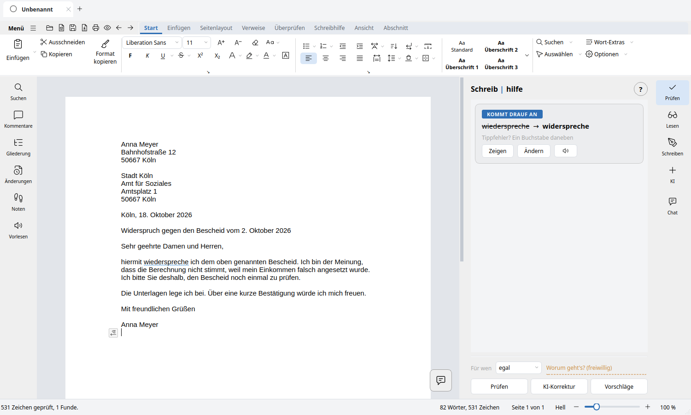
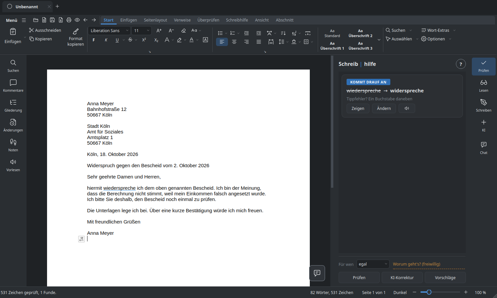
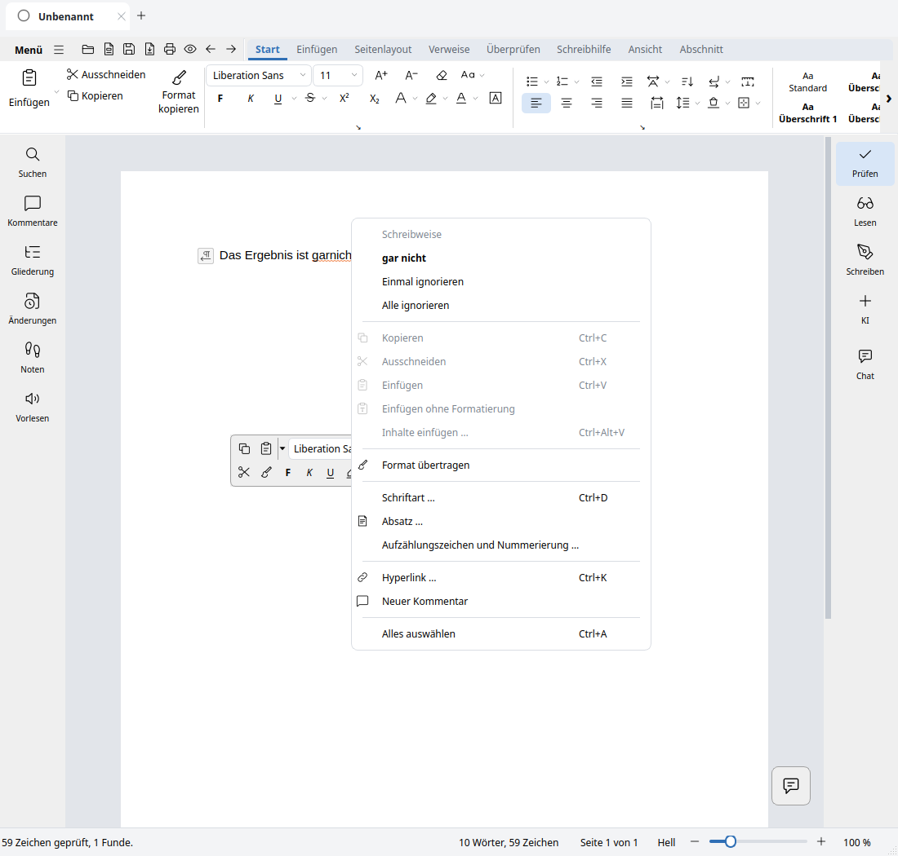
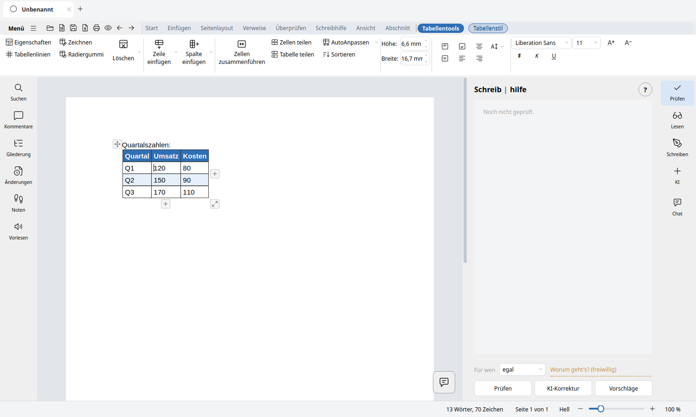
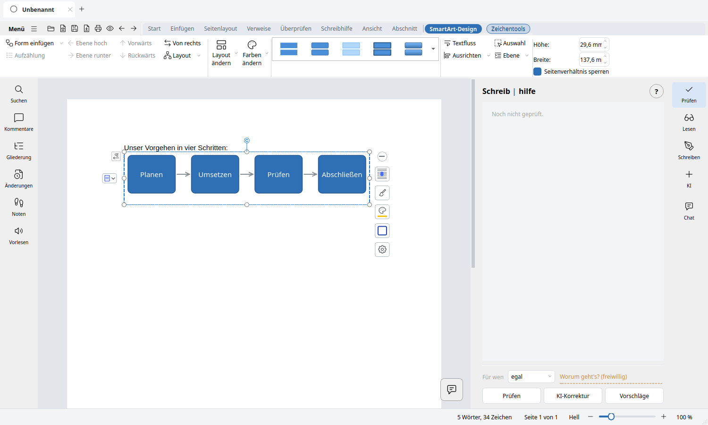
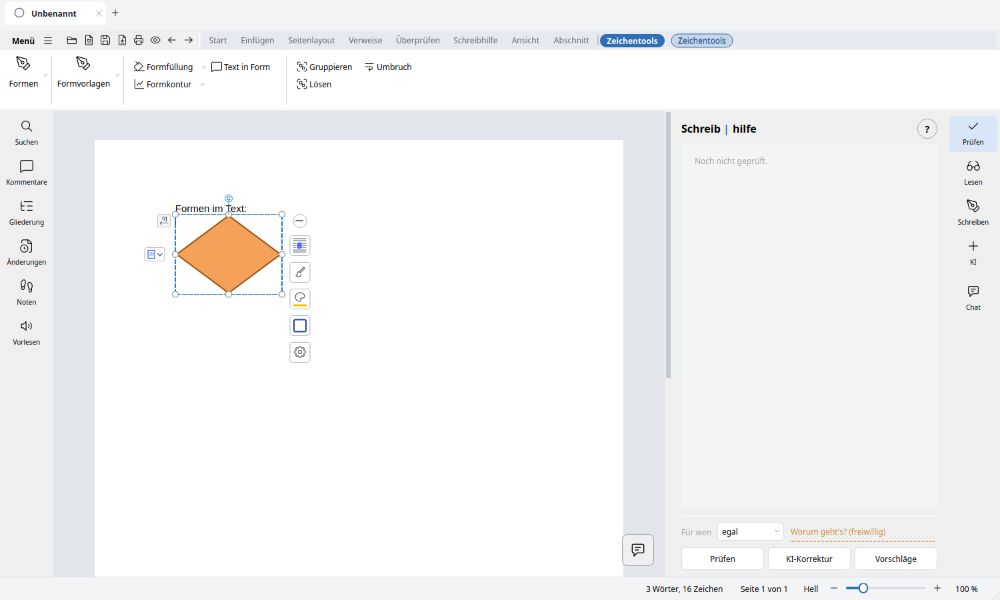

# Die Oberfläche

Band und Symbolleisten, das Lineal, Formatvorlagen, Anpassen.

**Zwei Oberflächen.** *Ansicht ▸ Oberfläche ▸ Benutzeroberfläche* stellt zwischen
Symbolleisten (zwei Zeilen, alles sichtbar) und Registern (Reiter) um. Dieselben Befehle, anders sortiert.

Das Register zeigt standardmäßig acht Reiter — Start, Einfügen, Seitenlayout,
Verweise, Überprüfen, Schreibhilfe, Ansicht, Abschnitt. *Sendungen* ist
vorhanden, aber ausgeblendet (einblendbar unter *Register anpassen*). Dazu
kommen Kontext-Reiter, die nur da sind, wenn sie etwas zu sagen haben.

**Der Reiter „Datei“ bleibt verborgen.** Links
vor den Reitern steht stattdessen **☰ Menü**: Neu, Öffnen, Speichern, Speichern unter, Als PDF
exportieren, Als Bild exportieren, Drucken, Dokumentverschlüsselung,
Hilfe, Optionen, Beenden. Es klappt als Tafel mit zwei Spalten auf —
links die Befehle, rechts die zuletzt benutzten Dateien. Ein Punkt mit
Pfeil legt kein Fenster darüber, er füllt die rechte Spalte.

Gleich daneben der **Schnellzugriff**: Öffnen, Neu aus Vorlage, Speichern,
Als PDF, Drucken, Druckvorschau, Rückgängig, Wiederholen (die Auswahl ist
anpassbar). Dasselbe ☰ steht auch
am Anfang der oberen Symbolleiste — beide Oberflächen tragen denselben
Aufbau.

**Die beiden Lineale** messen wirklich: Zentimeter mit Zahlen, vom
Satzspiegel aus gezählt, und drei Marken für die Einzüge,
die sich ziehen lassen — erste Zeile, links, rechts. Das helle Band zeigt,
wo Text steht, und wandert beim Ziehen mit. Das **senkrechte** misst von
der ersten Zeile abwärts und scrollt mit dem Blatt; es lässt sich einzeln
ein- und ausschalten, so wie es hält.

**Beim Schreiben.** Auf dem Reiter *Schreibhilfe* stehen in der Gruppe
*Beim Schreiben* drei Schalter — Wellenlinien, Wortvorhersage, AutoKorrektur.

**Die rechte Maustaste.** Zwei Kästen: oben eine
schwebende Formatleiste — Schriftart, Größe, fett, kursiv, Farbe, Marker,
Ausrichtung, Pinsel —, darunter ein kurzes Menü mit Bild links und
Tastenkombination rechts.

Es zeigt nur, was an dieser Stelle etwas bewirkt: auf einem Hyperlink
bearbeiten und entfernen, in einer Tabelle Zeilen und Spalten, auf einem
Bild Größe und Umbruch. Was gerade nicht geht, steht **grau** da statt zu
fehlen — ein Punkt, der mal da ist und mal nicht, lässt sich nicht lernen.

Auf einem Wort sieht das Programm auch dann nach, wenn noch gar nicht
geprüft wurde: Wer auf *garnicht* klickt, bekommt *gar nicht* — nicht eine
Liste ähnlich klingender Wörter.

**Tabellenwerkzeuge** erscheinen, sobald der Zeiger in einer Tabelle steht,
und verschwinden wieder; dazu Bildtools, Zeichentools, Texttools,
Diagrammtools, SmartArt-Design, Kopf- und Fußzeile sowie Mailings (siehe
[Aufbau des Bandes](../architektur/aufbau-band.md)).

 Die Gruppen folgen
dem Menüband: *Start* trägt Zwischenablage, Schriftart, Absatz,
Stile, Extras, Suchen, Auswählen und Einstellungen, *Ansicht* beginnt mit den Ansichten und
nicht mit dem Zoom. Die Befehle sind über Register, Menü und Symbolleisten erreichbar. Auf *Start* steht der

**Formatvorlagen-Katalog**: Er zeigt die Vorlage, statt sie zu benennen —
acht Kacheln in zwei Zeilen. Der Pfeil daneben klappt sie groß auf — an
derselben Stelle, so dass das Menü die Gruppe verdeckt und nichts doppelt
dasteht. Darin alle Vorlagen samt den eigenen, dazu *Neue Formatvorlage*,
*löschen* und *verwalten*.

**Eigene Formatvorlagen.** Was fehlt, legt man selbst an: eine
*Anschrift*, die immer rechts steht, ein *Merksatz* in Grau. Der Dialog
fragt nach Name und worauf sie aufbaut; die Formatierung steht darunter in
zwei Leisten — oben die Schrift, darunter der Absatz — und ganz unten eine
Vorschau, die sich beim Tippen mitändert. Wer „baut auf" umstellt, sieht
die übrigen Felder mitgehen. Eigene Vorlagen gehören zum Dokument und
wandern mit dem Reiter.
Wo eine Gruppe nicht alles zeigt, was es gibt, steht unten rechts ein

**Pfeil ⭨** zum vollen Dialog. Ein **Doppelklick auf den Reiter** klappt
das Band weg und wieder auf.

Die **Menüleiste** ist standardmäßig ausgeblendet; *Ansicht ▸ Oberfläche ▸
Menüleiste* schaltet sie ein. Die Befehle des ☰ Menüs stehen unabhängig davon
immer zur Verfügung. Symbolgröße und die Schrift der
Bedienung sind einstellbar — wer die Leisten nicht lesen kann, benutzt sie
nicht.

**Das Register anpassen.** Rechtsklick auf eine freie Stelle im Band, oder
*Ansicht ▸ Oberfläche ▸ Register anpassen*: Die Gruppen eines Reiters lassen sich
umsortieren und einzeln ausblenden. Verschoben wird mit zwei Pfeilen und
nicht mit der Maus — Ziehen und Ablegen verlangt eine ruhige Hand, ein
Pfeil nach oben trifft immer. Ausgeblendetes bleibt blass in der Liste
stehen, damit man es zurückholen kann.

**Ein Symbol austauschen.** Rechtsklick auf einen Knopf — im Band wie in
den Symbolleisten. Ein Fenster zeigt, wo die Zeichnung überall benutzt
wird, dazu ein Suchfeld und eine große Auswahl an Zeichnungen. Ein Klick, und
sie ist getauscht; „Zurücksetzen" holt die alte zurück. Das gilt für das Band
wie für die Symbolleisten.

**Einheitliche Symbolsprache.** Funktionssymbole kommen aus dem zentralen
Lucide-Katalog und werden über denselben Renderer ausgegeben: im 24er-Raster,
mit konsistenter Kontur und abgerundeten Linienenden. Das gilt auch für Datei-,
Druck- und Seitenleistenaktionen und bleibt unabhängig vom Desktop-Theme.

---

[← Zurück zum README](../../README.md)
