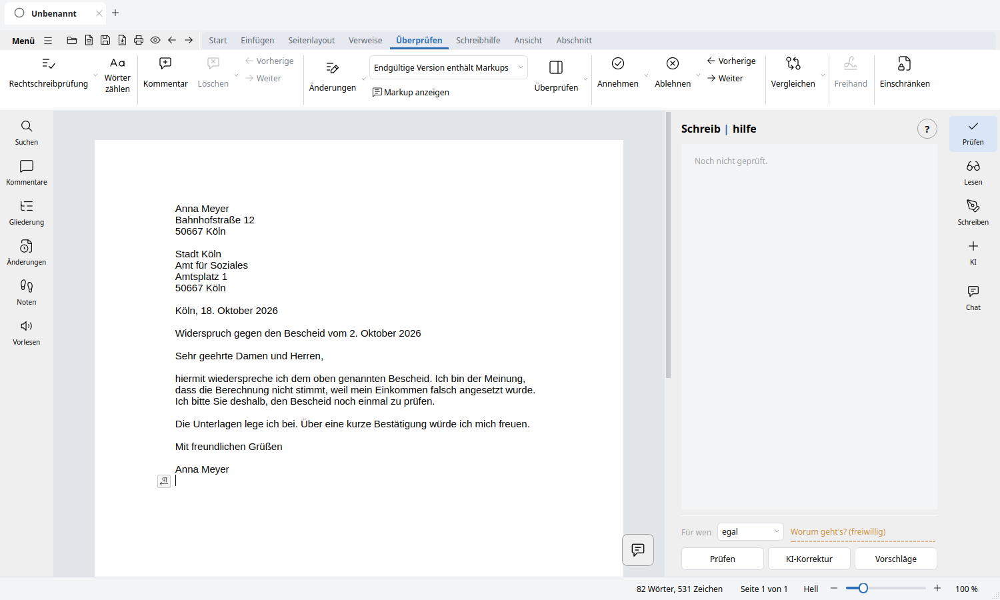

# Prüfung, Vorhersage und KI

Was Lunivo an einem Text findet — und was es dabei nicht tut.

**Welche Hilfe wann?** (F6) auf die Seite, die alle sechs Stufen erklärt —
und dort lässt sich jede auch gleich umlegen oder auslösen.

**Prüfen.** Der Knopf *Prüfen* (F7) legt jeden Fund als Karte in die
Seitenleiste und zieht im Text eine Wellenlinie darunter. Wer die
Wellenlinien nicht mag, schaltet sie aus — über die Marke *Wellen*, über
*Schreibhilfe ▸ Beim Schreiben ▸ Rechtschreibprüfung* oder über
*Überprüfen ▸ Rechtschreibprüfung*. Die Funde bleiben dann in der
Seitenleiste; angestrichen wird nichts mehr, auch nicht nach *Prüfen*. Auf jeder Karte
steht ein **Ohr**: Es liest den Vorschlag samt Begründung vor. Wer zwischen
„das" und „dass" unsicher ist, hört den Unterschied oft schneller, als er
ihn sieht.

**Die Brücke zwischen den Stufen.** Die Funde aller Stufen — eigene Prüfung
(Rechtschreibung, Grammatik und Stil), LanguageTool (*Gründlich prüfen*) und
die KI-Vorschläge — laufen durch einen gemeinsamen Vermittler, die
Schreibhilfe (`korrektur/korrektur_dienst.py`). Jede Stufe liefert ihre Funde
getrennt nach Herkunft; keine ersetzt die einer anderen. Eine neue eigene
Prüfung lässt die Funde von LanguageTool und KI stehen. Wo sich Funde
überschneiden, bleibt der beste (zuerst nach Sicherheit, dann nach Art, dann
nach Herkunft); die unterlegenen werden nicht angezeigt, aber vermerkt.
Dazu stimmt die Brücke die Stufen ab (`korrektur/fund.py`, `abstimmen`):
Melden zwei Stufen dieselbe Stelle mit demselben Vorschlag, gilt der Fund
als bestätigt. Widersprechen sich die Stufen, wird aus „Fehler“ ein „Tipp“,
statt etwas Unsicheres als sicheren Fehler anzustreichen. Wörter, die du in
Ruhe gelassen hast, zeigt keine Stufe mehr als Fehler; selbst Gelerntes
bleibt davon ausgenommen. Eine Gegenprobe senkt unbestätigte, unsichere
eigene Funde ab, wenn LanguageTool oder die KI den Bereich geprüft und
nichts gefunden haben. Sie ist vorsichtig voreingestellt: aus
(`schreibhilfe/konsens_gegenprobe`), und sie blendet nie etwas aus. Ein
abgesenkter Fund bleibt sichtbar, wird aber von „Alles Eindeutige
übernehmen“ nicht mehr automatisch geändert.
Die Schalter wirken je Stufe: *Wellen* steuert nur die Wellenlinien im Text,
nicht die Prüfung, die Seitenleiste oder das Rechtsklick-Menü.
*KI-Korrektur* (F8) ersetzt den Text dagegen direkt und erzeugt keine Funde.

**Wortvorhersage.** Ab drei Buchstaben stehen passende Wörter zur Wahl.
Wiedererkennen ist leichter als Erinnern.

**Phonetische Suche.** Wer „kwalität" schreibt, meint *Qualität*; wer
„fileicht" schreibt, meint *vielleicht*. Ein Buchstabenabstand findet das
nicht — der Klang schon (Kölner Phonetik). Das ist für Menschen gedacht, die
so schreiben, wie sie das Wort hören (Legasthenie). Die Klang-Stufe ist ein
eigener Prüfer der Schreibhilfe (`klang`, Schalter
`schreibhilfe/pruefer_klang`): *Prüfen* (F7) meldet solche Wörter als
Karte mit „Klingt wie …“, nicht nur der Rechtsklick. Sie meldet nur klare
Fälle als Tipp und schweigt bei Namen, Fachwörtern und Zusammensetzungen.
Abgedeckt sind v/f/w und ph, ie/i/ih, Dehnungs-h, Doppelkonsonanten,
sch/sp/st, ß/ss, b/p und b/d, p/q. Buchstabendreher und ausgelassene
Buchstaben findet weiter der Tippfehler-Prüfer.

**Die Wortliste.** Alle Stufen, die ein Wort nachschlagen — Rechtschreibung,
Klang, Vorhersage, Rechtsklick-Vorschläge —, benutzen dieselbe Liste
(`src/lunivo_writer/ressourcen/daten/woerter.txt`, rund 355.000 Wörter). Sie
stammt aus dem früheren Projekt des Autors,
[schreibhilfe](https://github.com/nullforge86/schreibhilfe), und ist
eigene Arbeit; Fremdlizenzen gelten für sie nicht.

**KI, wenn man will.** Korrigieren, Umformulieren, Übersetzen — über Claude
im Netz oder über ein Modell auf dem eigenen Rechner (Ollama). Die Korrektur
richtet sich danach, **für wen** der Text ist: Ein Brief ans Amt wird anders
korrigiert als eine Nachricht an einen Freund. Die *Vorschläge* der KI
erscheinen wie alle anderen Funde als Karten in der Seitenleiste und löschen
die Karten der übrigen Stufen nicht mehr.

**Eigene Dokumente durchsuchen.** In den KI-Einstellungen, Reiter „Dokumente“,
gibt man Ordner frei. Lunivo liest darin DOCX, ODT, RTF, TXT und PDF (mit Text),
zerlegt sie nach Überschriften (PDF: nach Seiten) in Abschnitte und legt einen
Suchindex (SQLite FTS5) im Programmdatenordner an (`dokumentindex.sqlite`). Zu
einer Frage im KI-Chat bekommt die KI die passenden Abschnitte als Quellen; unter
der Antwort stehen die Fundstellen mit Dateiname und Abschnitt oder Seite. Der
Index wird beim Fragen (höchstens ein paar Sekunden lang) und auf „Jetzt
indexieren“ nur für neue oder geänderte Dateien aktualisiert; entfernte Dateien
und zurückgenommene Freigaben verschwinden daraus. Es gibt keinen Hintergrunddienst.
Gelesen wird nur unterhalb der freigegebenen Ordner (keine Links, keine
versteckten Ordner). Bei einem Online-Modell gehen die Auszüge nur mit der
Zustimmung für „Auszug“ hinaus; mit Ollama bleibt alles auf dem Rechner.
Grenzen: gescannte PDFs ohne Text und PDF-Tabellen werden nicht gelesen; die
Suche ist eine Wortsuche (mit Wortanfängen), keine Bedeutungssuche.
Code: `src/lunivo_writer/ki/dokumentensuche.py`, `dokument_abschnitte.py`.

**Übersetzen, auch ohne KI.** Für die Aufgabe „Übersetzung“ gibt es in der
Modellzuweisung drei Wege: ein bestimmtes KI-Modell, **Lokal (offline)** mit
Argos Translate (der Text verlässt den Rechner nie) und **Automatisch** (KI,
wenn eine eingeschaltet, erreichbar und erlaubt ist, sonst lokal; schlägt die
KI fehl oder wird der Datenschutz-Hinweis abgelehnt, wird einmal lokal
übersetzt). Im Ergebnis steht, womit übersetzt wurde („KI“ oder „Lokal“).
Deutsch ↔ Englisch liegt der `.deb` bei; weitere Sprachen lädt man nur auf
Wunsch im Bereich „Offline-Sprachen“ der Schreibhilfe-Einstellungen. Die
Bibliothek ist ein optionales Extra (`pip install .[offline]`); ohne sie
startet Lunivo trotzdem, nur die lokale Übersetzung meldet dann, dass sie fehlt.
Code: `src/lunivo_writer/ki/argos.py`.

---

[← Zurück zum README](../../README.md)
