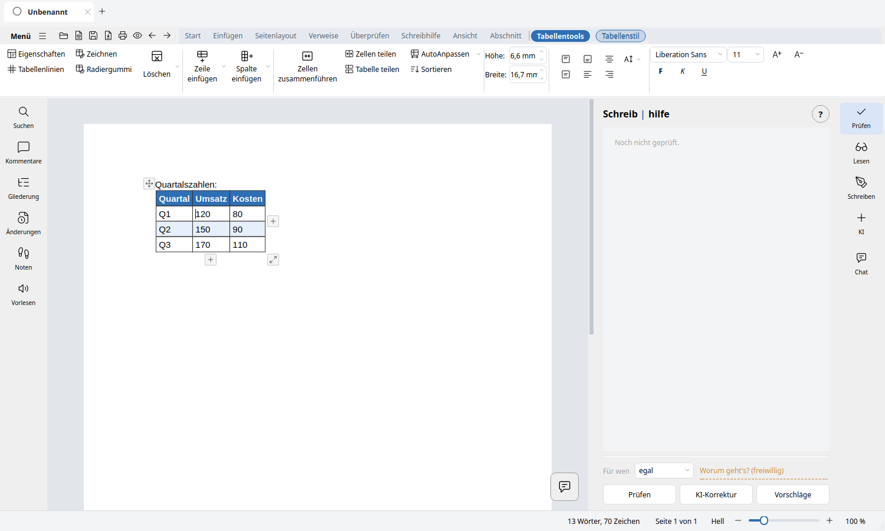

# Tabellen, Dokumentensteuerung und Bilder

**Woher diese Liste stammt.** Aus dem Programm selbst: Die Namen und Orte stammen aus der Banddefinition
(`src/lunivo_writer/ressourcen/register.json`, `src/lunivo_writer/oberflaeche/band/reiter/`, `src/lunivo_writer/oberflaeche/kontext/`) und den Befehlen unter
`src/lunivo_writer/kern/befehle/`. Welche Knöpfe in welchem Reiter stehen, zeigt [Aufbau des Bandes](../architektur/aufbau-band.md).

---

## Tabellen

| Funktion | Wo / Name in Lunivo |
|---|---|
| Tabelle einfügen | *Einfügen ▸ Tabelle*: Raster mit 10 × 10 Zellen, darunter „Tabelle einfügen“ (Fenster) |
| Tabelle zeichnen | *Einfügen ▸ Tabelle ▸ Tabelle zeichnen* |
| Text in Tabelle umwandeln | *Einfügen ▸ Tabelle*; nur wählbar, wenn Text markiert ist und der Zeiger nicht in einer Tabelle steht |
| Tabelle in Text konvertieren | *Einfügen ▸ Tabelle*; nur wählbar, wenn der Zeiger in einer Tabelle steht |
| Tabellenwerkzeuge | Kontext-Reiter **Tabellentools**, sobald der Zeiger in einer Tabelle steht |
| Tabellenformatvorlagen | *Tabellentools ▸ Tabellenformatvorlagen* mit den Schaltern Kopfzeile, Gebänderte Zeilen, Erste Spalte |
| Rahmen und Schattierung | *Tabellentools*: Rahmenlinien ein/aus, Zellenschattierung |
| Zeilen und Spalten einfügen | Zeile oberhalb / unterhalb, Spalte links / rechts einfügen |
| Löschen | Zeile, Spalte, Tabelle löschen |
| Zellen verbinden und teilen | *Tabellentools ▸ Zellen*: Zellen verbinden, Zelle teilen |
| Sortieren | *Tabellentools ▸ Zellen ▸ Tabelle sortieren* |
| Zellenausrichtung | *Tabellentools ▸ Ausrichtung*: oben, mittig, unten |

---

## Dokumentensteuerung

| Funktion | Wo / Name in Lunivo |
|---|---|
| Seite einrichten | *Seitenlayout ▸ Seite einrichten*: Orientierung, Größe, Spalten, Textrichtung, Umbrüche, Zeilennummern; Ränder in der Gruppe *Ränder* |
| Kopfzeile / Fußzeile | *Einfügen ▸ Kopf- und Fußzeile*; Kontext-Reiter **Kopf- und Fußzeile** |
| Seitenzahl | *Einfügen ▸ Kopf- und Fußzeile ▸ Seitenzahl* |
| Seiten-, Spalten- und Zeilenumbruch | *Start ▸ Absatz ▸ Umbrüche* und *Seitenlayout ▸ Seite einrichten ▸ Umbrüche* (Zeilenumbruch, Seitenumbruch, Spaltenumbruch, Textflussumbruch) |
| Abschnitte | Reiter **Abschnitt**: Abschnitt hinzufügen (vier Abschnittsumbrüche), löschen, einrichten, vorheriger / nächster Abschnitt, Abschnittsnavigationsbereich |
| Erste Seite anders, gerade / ungerade Seiten | Reiter **Abschnitt ▸ Kopf- und Fußzeile** |
| Verknüpfung mit vorheriger Kopf-/Fußzeile | Reiter **Abschnitt ▸ Kopf- und Fußzeile** |
| Wasserzeichen | *Einfügen ▸ Kopf- und Fußzeile ▸ Wasserzeichen* |
| Lesezeichen | *Einfügen ▸ Links ▸ Lesezeichen* |
| Änderungen nachverfolgen | *Überprüfen ▸ Nachverfolgung* |
| Navigationsbereich | *Ansicht ▸ Anzeigen ▸ Navigationsbereich* |
| Gliederung | *Ansicht ▸ Dokumentansichten ▸ Weitere Ansichten ▸ Gliederung* |
| Bearbeitung einschränken | *Überprüfen ▸ Schützen ▸ Bearbeitung einschränken* |

---

## Bilder

| Funktion | Wo / Name in Lunivo |
|---|---|
| Bildtools | Kontext-Reiter **Bildtools**, sobald ein Bild markiert ist |
| Bild einfügen | *Einfügen ▸ Illustrationen ▸ Bild*: Bild aus Datei, Bildschirmfoto, Piktogramm |
| Größe | Griffe am Bild; „Größe und Seitenverhältnis …“, „Auf Seitenbreite“, „Originalgröße“, „Größe zurücksetzen“, „Seitenverhältnis sperren“ |
| Zuschneiden | *Bildtools ▸ Größe ▸ Zuschneiden* und „Zuschneiden nach Maß …“ |
| Drehen | Griff zum freien Drehen; „Um 90° nach rechts / links drehen“ |
| Farbe und Helligkeit | Farbe, Heller, Dunkler, Kontrast erhöhen / verringern, Transparente Farbe einstellen |
| Bildeffekte und Rahmen | *Bildtools ▸ Farbe*: Bildeffekte, Rahmen |
| Zurücksetzen / Entfernen | Bild zurücksetzen, Bild entfernen |
| Anordnen | Textumbruch Stil, Gruppieren, Ausrichten, Eine Ebene nach vorne / hinten |
| Alternativtext | *Bildtools ▸ Weitere ▸ Alternativtext …* |
| Bilder komprimieren | *Bildtools ▸ Komprimieren* |

---

[← Zurück zum README](../../README.md) · [Der Aufbau der Optionen](../architektur/aufbau-optionen.md)
